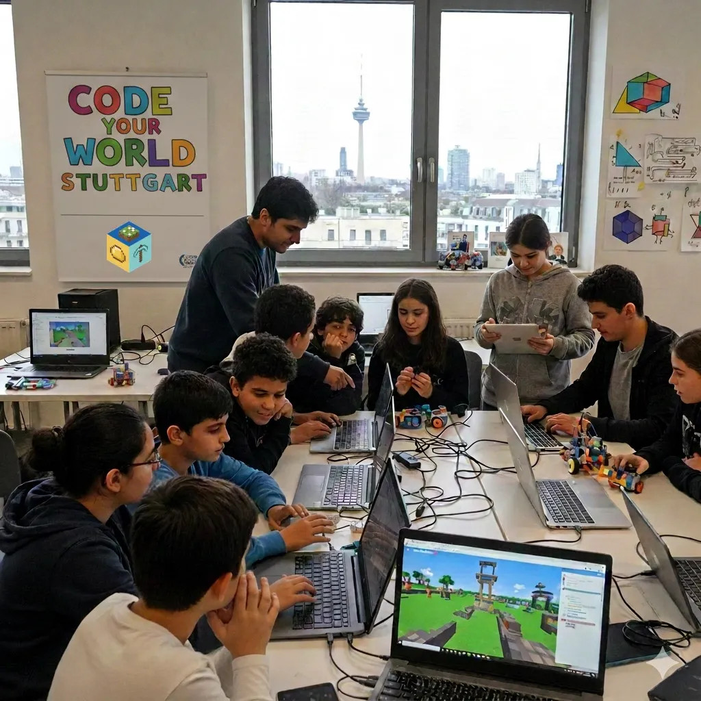

## Programmierangebote für geflüchtete Kinder und Jugendliche in Stuttgart

<figure style="text-align: center;">
  
  <figcaption><i>Bild KI-generiert von Gemini</i></figcaption>
</figure>

Geflüchtete Kinder und Jugendliche stehen in Deutschland oft vor besonderen Herausforderungen, wenn es um Bildung und Integration geht. Sprachliche Barrieren, ein fehlender Zugang zu digitalen Lernmitteln und traumatische Erfahrungen erschweren häufig die Teilhabe am schulischen Alltag. Deshalb werden Bildungsangebote für geflüchtete Kinder und Jugendliche häufig gezielt auf ihre besonderen Bedürfnisse ausgerichtet. Sie sollen nicht nur Wissen vermitteln, sondern auch Sicherheit, psychosoziale Stabilität, Sprachförderung und kulturelle Teilhabe fördern. Der pädagogische Ansatz betont daher nicht nur die Vermittlung von Lerninhalten, sondern auch die Schaffung eines vertrauensvollen und motivierenden Umfelds, in dem Lernen als gemeinschaftliches Erlebnis erfahren wird.

Spielbasierte Lernumgebungen wie Minecraft, Luanti, Roblox Education, Kerbal Space Program oder CodeCombat bieten hier eine besondere Chance. Diese Computerspiele schaffen eine vertraute und interaktive Atmosphäre, in der Kinder unabhängig von ihrer Sprache oder Herkunft miteinander lernen können. Durch gemeinsames Bauen, Forschen und Programmieren entwickeln sie soziale, sprachliche, mathematische und digitale Kompetenzen. Gleichzeitig stärken sie ihr räumliches Denken und ihre Fähigkeit zur Zusammenarbeit. Ziel ist eine motivierende und partizipative Lernkultur, in der jedes Kind seine Stärken entfalten und Selbstvertrauen aufbauen kann.

### Integrationsprojekte mit digitalen Medien in Stuttgart

In Stuttgart gibt es eine breite Palette an Bildungs- und Integrationsinitiativen, die sich der digitalen Teilhabe widmen. Sie verbinden Medienbildung, kreative Technologien und soziales Lernen miteinander. Ziel dieser Programme ist es, Kindern und Jugendlichen mit unterschiedlichen Hintergründen den Zugang zu modernen Lernformen zu ermöglichen und gleichzeitig Gemeinschaft, Selbstwirksamkeit und Chancengleichheit zu fördern.

#### **Mobile Medienschule Stuttgart Ost (MoMO)** – Offene Gaming- und Coding-Werkstätten

Die MoMO (unter anderem getragen von der Stuttgarter Jugendhaus gGmbH und der Merz Akademie) bietet in mehreren Jugendhäusern offene Medienwerkstätten an. Jeden Freitag findet in der *ComputerSpielSchule Stuttgart* ein betreutes Programm statt, das gemeinsames Computerspielen, Game-Design-Workshops und Programmieren umfasst. Ein besonderes Angebot ist ein wöchentliches Online-Programm mit **„Luanti“**, einer quelloffenen, Minecraft-ähnlichen Spieleplattform. Hier bauen und erkunden Jugendliche unter Anleitung von Medienpädagog*innen gemeinsam virtuelle Welten. Dieses Angebot wurde während der Pandemie etabliert und anschließend fortgeführt (2).

#### **AWO-Projekt “Kids Cube”** – Empowerment und Medienkompetenz in Unterkünften

Die AWO Stuttgart startete 2023 das Projekt *Kids Cube* für Kinder im Alter von 8 bis 12 Jahren aus Gemeinschaftsunterkünften. Im Mittelpunkt steht ein von den Kindern mitgestaltetes, modular aufgebautes Möbelstück („Kids Cube“), das als Lern- und Spielort dient. Anders als bei klassischen Programmierangeboten liegt der Schwerpunkt hier nicht auf IT- oder Programmierkenntnissen, sondern auf allgemeiner Medienkompetenz. Die Kinder lernen den bewussten, kreativen und sicheren Umgang mit digitalen Medien, beispielsweise beim Fotografieren, Filmen oder Recherchieren im Internet. Begleitet wird das Projekt durch ein einjähriges Empowerment-Programm mit Workshops zu Medienkompetenz, sozialer Teilhabe und Gesundheit. Die Angebote finden an wechselnden Standorten in den Unterkünften der Stadt statt (2).

#### **AWO “Lernraum”** – Digitale Lernorte in Übergangswohnheimen

Ergänzend dazu hat die AWO Stuttgart in mehreren Unterkünften Lernräume eingerichtet, um die Bildungsteilhabe geflüchteter Kinder und Jugendlicher zu fördern. Dort können sie nach der Schule ihre Hausaufgaben erledigen oder digitale Lernangebote auf bereitgestellten Laptops nutzen. Ehrenamtliche Lernhelfer*innen begleiten und unterstützen sie dabei individuell (3).

#### **Refugees4Refugees** – Computerkurse von Geflüchteten für Geflüchtete

Das Netzwerk *Refugees4Refugees*, das von der Evangelischen Gesellschaft Stuttgart unterstützt wird, ist eine Selbstorganisation von Geflüchteten. Neben Beratungsangeboten organisiert das Netzwerk auch Workshops, beispielsweise niedrigschwellige Computerkurse für andere Geflüchtete (4). Dabei werden grundlegende Kenntnisse im Umgang mit Computern, dem Internet und Office-Anwendungen vermittelt.

#### **Hacker School @ Stuttgart** – Programmieren für alle Jugendlichen

Die *Hacker School* (eine bundesweite Initiative) führt mit Unterstützung der *Ferry-Porsche-Stiftung* seit 2021 kostenlose Programmierworkshops an Schulen in sozial benachteiligten Stadtteilen Stuttgarts durch. IT-Studierende vermitteln Schüler*innen an einem Vormittag spielerisch die Grundlagen des Programmierens, häufig anhand kreativer Themen wie der Spieleentwicklung. Das Programm richtet sich ausdrücklich an alle Jugendlichen ab etwa 11 Jahren und steht damit auch jungen Menschen mit Migrations- oder Fluchthintergrund offen (5)(6).

#### **Freizeit- und Ferienkurse mit Minecraft**

Mehrere private Anbieter im Raum Stuttgart veranstalten Ferienworkshops, in denen Minecraft zum Erlernen des Programmierens eingesetzt wird. Beispielsweise bietet *Forscherfreunde e.V.* Feriencamps wie das „Minecraft-Zukunftslabor“ an. Dort bauen Kinder und Jugendliche im Alter von 10 bis 14 Jahren in der Minecraft Java Edition eigene Welten und beschäftigen sich dabei mit Technik, Redstone-Schaltungen und logischem Denken. Diese Camps richten sich nicht speziell an geflüchtete Kinder und Jugendliche, stehen ihnen aber grundsätzlich ebenfalls offen (7).

#### **Lernmobil Stuttgart – Bildung auf Rädern**

Das *Stuttgarter Lernmobil* ist eine Initiative zur Förderung der Bildungsgerechtigkeit, die von der Stadt Stuttgart und ihren Partnerorganisationen ins Leben gerufen wurde. Ein umgebauter Bus fährt regelmäßig verschiedene Stadtteile an, insbesondere Quartiere mit eingeschränkter Bildungsinfrastruktur und Gemeinschaftsunterkünfte für Geflüchtete. Dort werden niedrigschwellige Lern- und Betreuungsangebote bereitgestellt – von der Hausaufgabenhilfe über die Leseförderung bis hin zu Mathematik- und Medienprojekten. Der Schwerpunkt liegt dabei auf der allgemeinen Bildungsförderung und weniger auf der gezielten Vermittlung von IT- oder Programmierkenntnissen. Dennoch werden Kinder durch den Einsatz digitaler Lernmittel behutsam an neue Technologien herangeführt. Ziel ist es, Bildungsangebote direkt zu den Kindern zu bringen und dadurch ihre Teilhabe und Lernmotivation zu stärken (11).

### Fazit

Spezielle Programmierkurse ausschließlich für geflüchtete Kinder und Jugendliche sind in Stuttgart selten. Das liegt einerseits daran, dass viele Initiativen auf integrative Bildungsformate setzen, in denen geflüchtete und einheimische Kinder gemeinsam lernen. Andererseits werden spezialisierte Angebote häufig ehrenamtlich organisiert und sind daher von den verfügbaren personellen und finanziellen Ressourcen abhängig. Dennoch gibt es inklusive Medien- und Programmierprojekte, an denen auch junge Geflüchtete teilnehmen können. Initiativen wie die ComputerSpielSchule Stuttgart bieten wöchentlich spielerische Zugänge zum Programmieren und zur Spieleentwicklung. Dabei kommen auch Minecraft-ähnliche Lernumgebungen wie Luanti zum Einsatz. Soziale Träger wie die AWO schaffen mit Projekten wie *Kids Cube* oder *Lernraum* geschützte Lern- und Spielräume in Gemeinschaftsunterkünften, in denen digitale Bildung mit betreuten Freizeitaktivitäten verbunden wird.

Darüber hinaus fördern Stiftungen und ehrenamtliche Netzwerke vielfältige digitale Lernangebote für junge Menschen mit Migrations- oder Fluchthintergrund – von einfachen Computerkursen bis hin zu professionell angeleiteten Programmierworkshops. Diese Projekte tragen dazu bei, dass geflüchtete Kinder und Jugendliche in Stuttgart digitale Kompetenzen erwerben und aktiv an der digitalen Gesellschaft teilhaben können. Interaktive Lernumgebungen wie Minecraft oder Luanti sind dabei meist nur einige von vielen pädagogischen Werkzeugen.

Ich besuche zweimal pro Woche eine Gemeinschaftsunterkunft für Geflüchtete in Stuttgart, um Kinder und Jugendliche bei ihren Hausaufgaben zu unterstützen und ihnen mit Minecraft spielerisch den Einstieg in die Welt des Programmierens zu ermöglichen. Jeder von uns kann etwas bewirken – sei es als Fachkraft, als ehrenamtlich engagierter Mensch oder einfach als jemand, der bereit ist, seine Zeit und Erfahrung mit anderen zu teilen. Wenn du Lust hast, dich einzubringen und junge Menschen auf ihrem Bildungsweg zu begleiten, freue ich mich über eine Nachricht an [andy.rytina@gmail.com](mailto:andy.rytina@gmail.com). 

*Dieser Artikel wurde größtenteils mit Unterstützung von ChatGPT erstellt.*

---

### Quellenverzeichnis

1. **ComputerSpielSchule Stuttgart**. 
   URL: [https://computerspielschule-stuttgart.de](https://computerspielschule-stuttgart.de)
   Ansprechpartner: Dejan Simonović und Ahmed Özcan.
2. **AWO Stuttgart**. „Kids Cube – Empowerment & Medienkompetenz.“  URL: [https://awo-stuttgart.de/migration/projekte-fuer-gefluechtete-kinder-und-jugendliche/awo-kids-cube](https://awo-stuttgart.de/migration/projekte-fuer-gefluechtete-kinder-und-jugendliche/awo-kids-cube) 
   Träger: AWO Stuttgart, gefördert durch Bürgerstiftung Stuttgart und Mercedes-Benz. Ansprechpartner: Edith Robin / Athanasios Axiotidis ([kidscube@awo-stuttgart.de](mailto:kidscube@awo-stuttgart.de)).
3. **AWO Stuttgart**. „Lernraum – Digitale Lernorte in Übergangswohnheimen.“ *awo-stuttgart.de*. 
   [https://awo-stuttgart.de/migration/projekte-fuer-gefluechtete-kinder-und-jugendliche/lernraum](https://awo-stuttgart.de/migration/projekte-fuer-gefluechtete-kinder-und-jugendliche/lernraum)
    Standort-Beispiel: GU Stuttgart-Stammheim. Kontakt: Sophia Kästel.
4. **Evangelische Gesellschaft Stuttgart (eva)**. ([https://www.eva-stuttgart.de/unsere-angebote/angebot/migration-angebote-und-unterstuetzung-finden](https://www.eva-stuttgart.de/unsere-angebote/angebot/migration-angebote-und-unterstuetzung-finden))
   „Flüchtlinge für Flüchtlinge“
   URL: [https://refugees4refugees.org](https://refugees4refugees.org)
   Ort: wechselnde Räume, z.B. Internationales Beratungszentrum der eva. Kontakt: über Plattform „Flüchtlinge für Flüchtlinge“. Ansprechpartner: Rex Osa.
5. **Ferry-Porsche-Stiftung**. „Hacker School @ Stuttgart (Projektseite).“ 
   [https://ferry-porsche-stiftung.de/projekte/hacker-school-programmieren-lernen-fur-kinder-und-jugendliche](https://ferry-porsche-stiftung.de/projekte/hacker-school-programmieren-lernen-fur-kinder-und-jugendliche)
6. **Hacker School gGmbH**. „Hacker School – Offizielle Website.“ URL: [https://www.hacker-school.de](https://www.hacker-school.de)
7. **Forscherfreunde e. V.**. „Minecraft-Zukunftslabor (Feriencamp).“ *forscherfreunde.de*. 
   [https://forscherfreunde.de/das-minecraft-zukunftslabor-10-14-jahre](https://forscherfreunde.de/das-minecraft-zukunftslabor-10-14-jahre)
8. **Stadt Stuttgart**. „Bildungsgerechtigkeit - Bildungsintegration“ 
   [https://www.stuttgart.de/leben/bildung/bildungsgerechtigkeit/bildungsintegration](https://www.stuttgart.de/leben/bildung/bildungsgerechtigkeit/bildungsintegration)
9. **Mobile Medienschule Stuttgart Ost** (MoMO) 
    URL: [https://medienschule-stuttgart.de](https://medienschule-stuttgart.de).
    Ansprechpartnerin: Isabel Huber.
10. **Bürgerstiftung Stuttgart**. Förderinitiative "Mittendrin" 
    URL: [https://www.buergerstiftung-stuttgart.de/die-projekte](https://www.buergerstiftung-stuttgart.de/die-projekte) 
11. **Stadtbibliothek Stuttgart** Schilling, Claudia: Das Stuttgarter Lernmobil – Bildung nimmt Fahrt auf!
    URL: [https://opus4.kobv.de/opus4-bib-info/frontdoor/deliver/index/docId/18392/file/Lernmobil_Schilling.pdf](https://opus4.kobv.de/opus4-bib-info/frontdoor/deliver/index/docId/18392/file/Lernmobil_Schilling.pdf)
    Träger: Stadt Stuttgart, unterstützt durch Stuttgarter Bildungseinrichtungen und Ehrenamtliche.